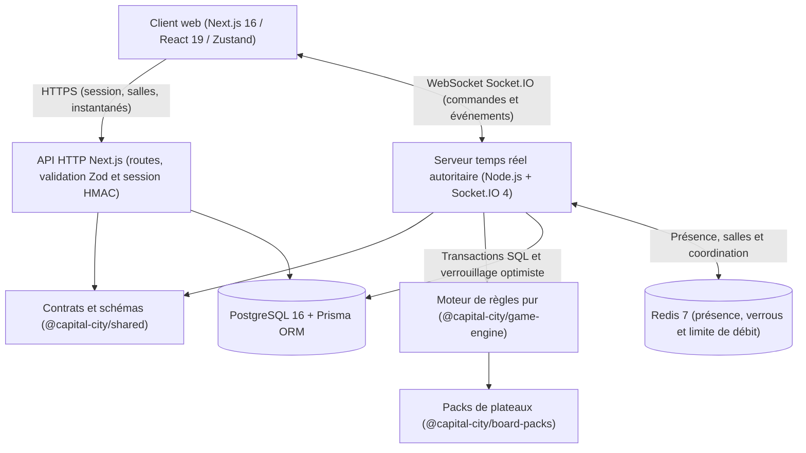

# Architecture technique de Capital City

## 1. Vue d'ensemble

**Capital City** repose sur une architecture **monorepo modulaire** combinant une application web Next.js (App Router) et un **serveur temps réel Socket.IO dédié et autoritaire**, articulés autour d'un **moteur de règles TypeScript pur et déterministe**.



## 2. Structure du monorepo

```text
capital-city/
├── apps/
│   ├── web/                # Frontend Next.js 16 (App Router), système graphique intégré et API HTTP
│   └── realtime/           # Serveur Socket.IO 4 autoritaire, persistance transactionnelle et reprise
├── packages/
│   ├── shared/             # Types partagés, schémas Zod, contrats HTTP/Socket, profils de règles
│   ├── game-engine/        # Bibliothèque pure TypeScript : règles, registre financier, cartes et invariants
│   └── ui/                 # Jetons graphiques et composants accessibles partagés
├── board-packs/
│   ├── asteria-city/       # 40 cases, 32 cartes, palette nocturne bleu nuit/turquoise et illustrations SVG
│   ├── riviera-district/   # 40 cases, 32 cartes, palette côtière sable/corail/azur et illustrations SVG
│   └── nova-frontier/      # 40 cases, 32 cartes, palette futuriste néon/obsidienne et illustrations SVG
├── prisma/
│   ├── schema.prisma       # Modèle relationnel PostgreSQL normalisé
│   ├── migrations/         # Migrations SQL versionnées et reproductibles
│   └── seed.ts             # Chargement initial des packs de plateaux et données de démonstration
├── docs/
│   ├── architecture.md     # Synthèse architecturale et flux de données
│   ├── architecture/       # Détails des sous-systèmes
│   ├── decisions/          # Décisions d'architecture (ADR-001 à ADR-003)
│   ├── gameplay/           # Référentiel complet des règles et de l'économie
│   └── deployment/         # Guide de mise en production, sauvegarde et restauration
└── tests/
    ├── integration/        # Tests d'intégration moteur, persistance et serveur Socket.IO
    └── e2e/                # Scénarios Playwright multi-navigateurs et captures visuelles
```

## 3. Responsabilités des couches

| Composant              | Responsabilités clés                                                                                                                                                                                                                                                     | Garanties                                                                  |
| ---------------------- | ------------------------------------------------------------------------------------------------------------------------------------------------------------------------------------------------------------------------------------------------------------------------ | -------------------------------------------------------------------------- |
| `packages/shared`      | Schémas Zod de toutes les commandes et réponses, types d'état client/serveur, constantes des pions et règles.                                                                                                                                                            | Contrat unique typé de bout en bout.                                       |
| `packages/game-engine` | Calcul déterministe des transitions `(state, actorId, command, rng) => { nextState, events }`. Registre monétaire centralisé.                                                                                                                                            | 0 dépendance IO/UI, 100 % testable hors navigateur, couverture >= 80 %.    |
| `board-packs/*`        | Définition déclarative JSON/TS des 40 cases, loyers, coûts de construction, groupes G1–G8, taxes, 16 cartes d'événement et 16 cartes de communauté, thèmes et illustrations.                                                                                             | Interchangeabilité totale sans modifier le moteur.                         |
| `apps/realtime`        | Authentification de session lors de la poignée de main Socket.IO, contrôle d'appartenance à la salle, vérification d'idempotence (`commandId`), exécution du moteur, transaction Prisma avec `version` optimiste, diffusion temps réel, minuteurs d'enchères et d'arrêt. | Autorité serveur stricte, reprise sur incident depuis PostgreSQL.          |
| `apps/web`             | Rendu des 17 interfaces, animations fluides respectant `prefers-reduced-motion`, audio synthétique optionnel, tutoriel interactif, routes HTTP d'initialisation de session et création/consultation de salles.                                                           | Ergonomie ordinateur et mobile, accessibilité WCAG 2.2 AA.                 |
| `PostgreSQL + Prisma`  | Persistance durable des utilisateurs/invités, salles, parties, joueurs, propriétés détenues, paquets de cartes, offres d'échange, journal immuable `GameEvent` et `GameSnapshot`.                                                                                        | Montants stockés en entiers (`Int`), intégrité transactionnelle ACID.      |
| `Redis`                | Suivi de présence socket par salle, verrous distribués légers par `gameId`, compteurs de limitation de débit.                                                                                                                                                            | Repli mémoire propre documenté pour le développement local hors conteneur. |

## 4. Flux de sécurité et d'exécution d'une commande

1. **Authentification** : lors du premier accès (mode invité ou pseudonyme personnalisé), `POST /api/session` crée ou récupère l'entrée `User` en base et émet un cookie `HttpOnly`, `SameSite=Lax` ainsi qu'un jeton de session signé HMAC (`userId`, `displayName`, `exp`) utilisé pour authentifier la connexion Socket.IO.
2. **Intention client** : le navigateur émet uniquement une intention typée (ex. `turn:roll`, `property:buy`, `auction:bid`) accompagnée d'un `commandId` UUID et de `expectedVersion`. Aucun résultat de dé ni montant de loyer n'est accepté du client.
3. **Validation et idempotence** : `apps/realtime` valide la charge utile avec Zod, applique la limitation de débit, vérifie que `commandId` n'a pas déjà été traité, et associe la session authentifiée au `Player` de la partie.
4. **Exécution et persistance atomique** :
   - Le moteur pur exécute la commande avec le générateur cryptographique serveur (`crypto.randomInt(1, 7)`).
   - Dans une transaction Prisma (`prisma.$transaction`), la partie est mise à jour avec contrôle de `version` (`WHERE id = gameId AND version = expectedVersion`), les tables normalisées (`Player`, `AssetOwnership`, `TradeOffer`, `GameEvent`) sont synchronisées, et un `GameSnapshot` est enregistré périodiquement.
5. **Diffusion** : les événements métier et le nouvel état consolidé sont diffusés à tous les membres de la salle Socket.IO.

## 5. Reprise après incident ou redémarrage

Au démarrage de `apps/realtime` (ou lors d'un `game:resume` sur une salle active non chargée en mémoire), le serveur :

1. Charge le dernier `GameSnapshot` (ou `Game.stateSnapshot`) depuis PostgreSQL.
2. Vérifie la cohérence avec la séquence d'événements `GameEvent` postérieurs éventuels.
3. Réhydrate la salle en mémoire, relance les minuteurs actifs (enchères, délai de grâce de déconnexion) et synchronise les clients reconnectés via `game:snapshot`.
