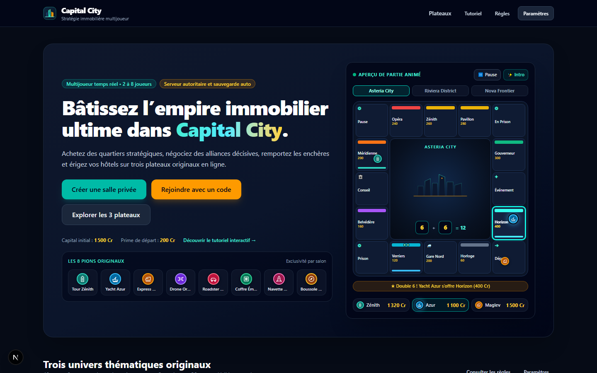
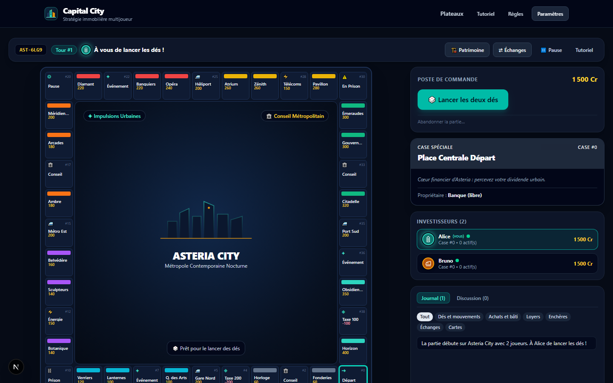

# Capital City — jeu de plateau immobilier web multijoueur

**Capital City** est une application web multijoueur temps réel de gestion et de stratégie immobilière au tour par tour (2 à 8 joueurs), conçue avec un moteur de règles TypeScript pur et déterministe, un serveur autoritaire Socket.IO, une persistance transactionnelle PostgreSQL / Prisma et trois univers thématiques originaux.





---

## Fonctionnalités clés

- **Multijoueur temps réel (2 à 8 joueurs)** : salles privées avec code court et lien d'invitation, sélection parmi 8 pions originaux, gestion de l'hôte, reconnexion transparente et reprise après redémarrage serveur.
- **Trois plateaux originaux (40 cases chacun)** :
  - **Asteria City** : métropole contemporaine nocturne aux tours de verre, bleu profond et turquoise.
  - **Riviera District** : cité côtière de prestige aux tons sable, corail et bleu azur.
  - **Nova Frontier** : univers futuriste aux surfaces d'obsidienne et néons technologiques.
- **Règles économiques et cas limites complets** :
  - Lancer de deux dés côté serveur, doubles, triple double vers la prison, prime de départ configurable.
  - Achat de terrains (8 groupes de couleur), 4 réseaux de transport et 2 services publics.
  - Enchères ouvertes en temps réel lors d'un refus d'achat ou d'une saisie bancaire.
  - Construction équilibrée (maisons et hôtels avec gestion stricte du stock de la banque : 32 maisons, 12 hôtels) et revente à 50 %.
  - Hypothèque (50 %) et levée d'hypothèque (+10 % d'intérêts).
  - 32 cartes originales typées par plateau (16 cartes d'événement et 16 cartes de communauté), incluant les cartes conservées de sortie de prison.
  - Échanges simultanés entre joueurs (propriétés, crédits, cartes de sortie de prison) avec aperçu et contre-proposition.
  - Gestion de dette, liquidation, faillite envers un joueur ou envers la banque, victoire au dernier joueur solvable ou au patrimoine.
- **Expérience soignée et accessibilité** :
  - Thème sombre moderne, typographie tabulaire pour les montants, animations fluides désactivables (`prefers-reduced-motion`), effets sonores Web Audio optionnels et tutoriel interactif de premier lancement.

---

## Guide développeur — installation et premier lancement

### 1. Prérequis

Vérifiez que les outils suivants sont installés :

- **Node.js** `>= 20.12 LTS` (recommandé : Node.js LTS 22/26) et **npm** `>= 10`
- **Git** `>= 2.40`
- **Docker Desktop** avec **Docker Compose v2** _(note : si Docker Desktop n'est pas démarré localement, le projet inclut un démon PostgreSQL 16 embarqué via PGlite TCP sur le port `5432` et un repli Redis automatique afin de garantir un démarrage immédiat en environnement restreint)._

```bash
node -v
npm -v
git --version
docker --version
docker compose version
```

### 2. Cloner ou ouvrir le projet

```bash
git clone <url-du-depot> capital-city
cd capital-city
```

Consultez également [ARCHITECTURE.md](./ARCHITECTURE.md) pour le détail des modules et flux temps réel.

### 3. Configurer les variables d'environnement

Copiez `.env.example` vers `.env` (ne committez jamais `.env`) :

```bash
# Linux / macOS / Git Bash
cp .env.example .env

# Windows PowerShell
Copy-Item .env.example .env
```

### 4. Démarrer PostgreSQL et Redis

**Option A — avec Docker Compose (recommandé)** :

```bash
docker compose up -d postgres redis
docker compose ps
```

**Option B — sans Docker actif (démon PostgreSQL embarqué persistant dans `.data/postgres`)** :

Les scripts `npm run db:migrate`, `npm run db:seed` et `npm run dev` détectent automatiquement si `127.0.0.1:5432` écoute déjà ; dans le cas contraire, ils démarrent automatiquement le serveur PostgreSQL local embarqué (`npm run db:daemon`).

### 5. Installer les dépendances

Installez exactement les versions verrouillées du monorepo via `package-lock.json` :

```bash
npm ci
```

### 6. Appliquer les migrations Prisma et charger les données initiales

```bash
npm run db:migrate
npm run db:seed
```

### 7. Démarrer l'application (frontend Next.js et serveur temps réel Socket.IO)

```bash
npm run dev
```

- **Application web (Next.js)** : http://localhost:3000
- **Serveur temps réel (Socket.IO / santé / métriques)** : http://localhost:4000/health

### 8. Vérifier une partie multijoueur locale

1. Ouvrez http://localhost:3000 dans un premier navigateur, choisissez un pseudonyme et cliquez sur **Créer une salle privée**.
2. Sélectionnez un plateau (`Asteria City`, `Riviera District` ou `Nova Frontier`), configurez les règles souhaitées et validez.
3. Copiez le **code d'invitation** affiché dans le salon (ex. `AST-4K9M`) ou le lien direct.
4. Ouvrez une fenêtre de navigation privée (ou un second navigateur) sur http://localhost:3000, cliquez sur **Rejoindre avec un code** et saisissez le code.
5. Choisissez chacun un pion distinct, passez à l'état prêt, puis cliquez sur **Lancer la partie** depuis la fenêtre de l'hôte.

---

## Commandes de qualité et tests

| Commande                | Description                                                                            |
| ----------------------- | -------------------------------------------------------------------------------------- |
| `npm run lint`          | Analyse statique ESLint sur l'ensemble du monorepo                                     |
| `npm run typecheck`     | Vérification TypeScript stricte (`tsc --noEmit`) sur tous les paquets et applications  |
| `npm run test`          | Exécution des tests unitaires et d'intégration (Vitest)                                |
| `npm run test:coverage` | Exécution des tests avec rapport de couverture V8 (`>= 80 %` requis sur `game-engine`) |
| `npm run test:e2e`      | Parcours bout-en-bout multi-navigateurs Playwright                                     |
| `npm run build`         | Compilation de production des paquets, du serveur temps réel et de l'application web   |
| `npm run format:check`  | Vérification du formatage Prettier                                                     |

---

## Captures visuelles vérifiées (ordinateur et mobile)

Les captures générées automatiquement par la suite Playwright (`npm run test:e2e`) sont consultables dans [`docs/screenshots/`](./docs/screenshots/) :

- `00-arrival-intro.png` — séquence animée d'ouverture à l'arrivée sur l'accueil
- `01-home-desktop.png` et `05-home-mobile.png` — page d'accueil en thème sombre (ordinateur `1440×900` et mobile `390×844`)
- `02-board-asteria-city.png`, `03-board-riviera-district.png`, `04-board-nova-frontier.png` — les 3 plateaux originaux de 40 cases et leurs fiches foncières
- `06-lobby-multiplayer.png` — salon multijoueur temps réel, sélection exclusive des 8 pions et réglages de l'hôte
- `07-game-desktop.png` et `08-game-mobile.png` — écran principal de partie en direct (ordinateur et mobile sans débordement)
- `09-auction-modal.png` — salle des enchères immobilières en direct avec compte à rebours serveur
- `10-asset-manager.png` — gestionnaire de patrimoine (constructions équilibrées et hypothèques)
- `11-trade-preview.png` — chambre de compensation des échanges avec étape obligatoire d'aperçu avant envoi

---

## Documentation complémentaire

- [ARCHITECTURE.md](./ARCHITECTURE.md) — architecture détaillée et flux temps réel
- [CHANGELOG.md](./CHANGELOG.md) — historique des versions SemVer
- [docs/architecture.md](./docs/architecture.md) — référence d'architecture système
- [docs/decisions/](./docs/decisions/) — décisions d'architecture (`ADR-001` à `ADR-003`)
- [docs/gameplay/rules.md](./docs/gameplay/rules.md) — spécification complète des règles et des 3 plateaux
- [docs/deployment/runbook.md](./docs/deployment/runbook.md) — déploiement Docker, sauvegardes et restauration
